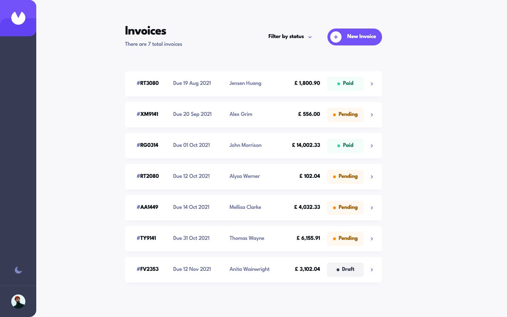

# Frontend Mentor - Invoice app solution

This is a solution to the [Invoice app challenge on Frontend Mentor](https://www.frontendmentor.io/challenges/invoice-app-i7KaLTQjl). My app lets users create, edit, filter and track invoices saved in their browser.

## Table of contents

- [Overview](#overview)
  - [The challenge](#the-challenge)
  - [Screenshot](#screenshot)
  - [Links](#links)
- [My process](#my-process)
  - [Built with](#built-with)
  - [What I learned](#what-i-learned)
  - [Continued development](#continued-development)
- [Run it locally](#run-it-locally)
- [Author](#author)

## Overview

### The challenge

Users should be able to:

- Use the app on phone, tablet and desktop screens, with hover and focus states for controls.
- Create invoices, save incomplete drafts and see validation errors for invalid fields.
- Add and remove line items, with calculated totals and payment due dates.
- View, edit and delete invoices, with confirmation before deletion.
- Mark pending invoices as paid.
- Filter by any mix of Draft, Pending and Paid.
- Switch between light and dark themes and keep their choice after reloading.
- Keep invoices after reloading. Once the list exceeds 10 invoices, search by client name or ID and show 10 more invoices at a time.

### Screenshot



### Links

- Solution URL: [My Frontend Mentor solution](https://www.frontendmentor.io/solutions/invoice-app-with-nextjs-typescript-and-tailwind-9ZVYr8FPyH)
- Live Site URL: [Invoice app](https://invoice-app.royeradames.com)

## My process

### Built with

- Next.js 16 App Router
- React 19 and TypeScript
- Tailwind CSS 4 and custom CSS
- TanStack Form for form state
- Zod for validation and storage parsing
- Browser localStorage and the Web Locks API
- Node.js test runner and Playwright for unit tests and browser journeys

### What I learned

I learned to keep decimal totals exact by storing prices as integer pence. I split the price text into pounds and pence before calculating it. Line totals use integer multiplication, and I derive the invoice total from its items instead of storing a second total.

I learned that an older tab must check what is saved before writing. I use the Web Locks API to allow one write at a time, then compare the saved JSON with the bytes that tab last read. If another tab has changed them, I stop the save and keep the user's changes on screen.

I learned to keep the list usable as it grows. I put new invoices at the top and show 10 invoices at a time. When there are more than 10, I show a client-name or ID search that checks all invoices matching the status filter, including rows that have not been shown yet.

### Continued development

- I still need a migration from the older v1 storage format. The app leaves that data untouched and reads only `invoice-app-v2`.

## Run it locally

Use Node.js 24.11.1 or newer.

```sh
npm ci
npm run dev            # development server at http://localhost:3000
```

For checks and the production server:

```sh
npm run lint
npm run typecheck
npm test               # domain and storage unit tests
npm run build && npm start -- -p 4395
npm run test:browser   # in another terminal, while the production server runs
```

The Playwright journeys use installed Google Chrome. They target `INVOICE_URL`, defaulting to `http://127.0.0.1:4395`, and accept local URLs only. They cover invoice flows, keyboard paths, empty states, form errors, themes and narrow layouts.

I save invoices, theme and filters in one versioned localStorage document. Zod validates stored data on reads and writes. Saving requires browser storage and the Web Locks API. Unreadable data stays untouched until an explicit reset, with a backup download available first.

This is a browser-only demo. Nothing is emailed, charged or sent anywhere. "Save & Send" marks an invoice pending. The initial invoices come from the challenge's `data.json`, not real customers. I converted prices to pence and normalized one date and a doubled space in an address; totals and due dates match the sample data.

I followed the official Figma frames at 375, 768 and 1440 px. I keep body text at 16 px or larger where the design uses 13 or 15 px, and adjust text colours for contrast. The calendar displays dates as "21 Aug 2021" in every locale. Payment terms use a styled native select. I self-host League Spartan under the SIL Open Font License, included in [app/fonts/OFL.txt](./app/fonts/OFL.txt).

## Author

- Website - [Royer Adames](https://royeradames.com)
- Frontend Mentor - [@royeradames](https://www.frontendmentor.io/profile/royeradames)
